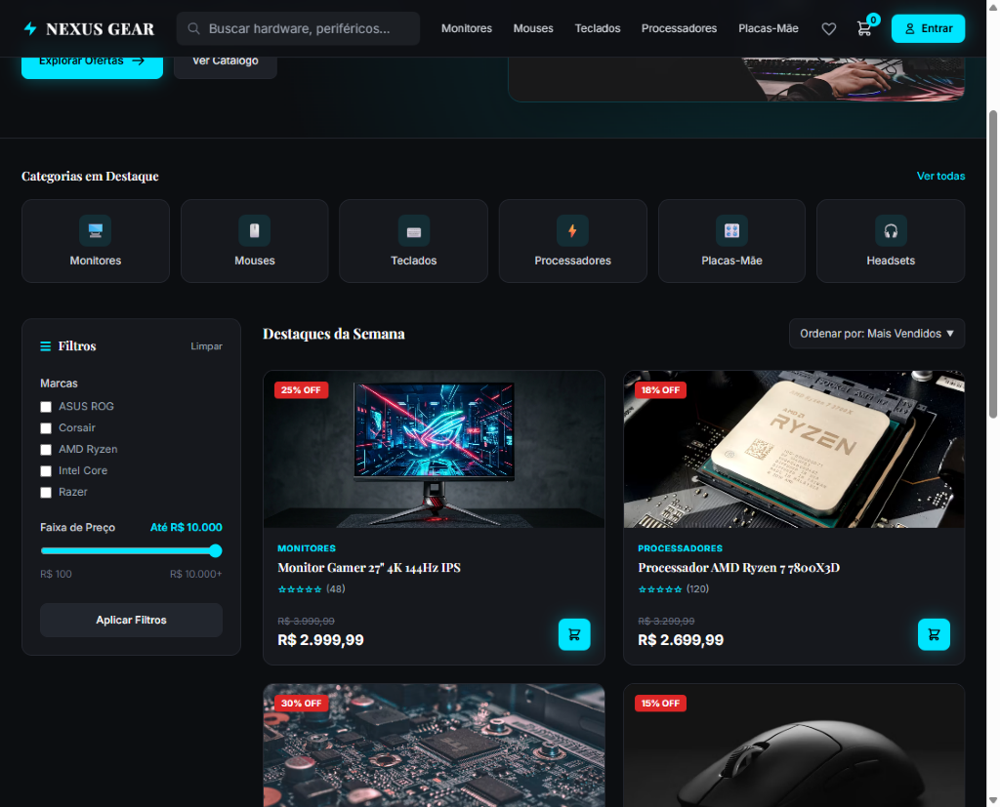

# NEXUS GEAR — E-commerce de Hardware com Persistência Poliglota

> **Trabalho da 3ª Avaliação — Projeto de Banco de Dados**  
> **Aluno:** Arthur Andrade Lima  
> **Aplicação Online (Render):** [https://nexus-gear-f9nn.onrender.com/#catalogoSection](https://nexus-gear-f9nn.onrender.com/#catalogoSection)

Aplicação Web de E-commerce e Catálogo de Hardware desenvolvida em **Java 17 (Spring Boot 3)** com interface em **HTML5, Tailwind CSS e JavaScript**, utilizando o conceito de **Banco de Dados Poliglota** para integrar **Supabase (PostgreSQL)**, **MongoDB** e **Redis** de acordo com o melhor caso de uso de cada tecnologia.

---

## Acesso Online (Deploy no Render)

O sistema encontra-se publicado e disponível gratuitamente na nuvem através do Render:
* **Link da Aplicação:** [https://nexus-gear-f9nn.onrender.com/#catalogoSection](https://nexus-gear-f9nn.onrender.com/#catalogoSection)

---

## Demonstração da Interface (Tela de Produtos)



---

## Arquitetura de Persistência Poliglota

| Banco de Dados | Modelo | Caso de Uso no Sistema | Implementação |
| :--- | :--- | :--- | :--- |
| **Supabase (PostgreSQL)** | Relacional (SQL) | Controle de autenticação/login seguro do **Administrador** (`admins`) e registro de histórico de pedidos enviados ao WhatsApp (`order_logs`). | `Spring Data JPA` + `PostgreSQL Driver` + `BCrypt` |
| **MongoDB** | Orientado a Documentos (NoSQL) | Cadastro e armazenamento do **Catálogo de Produtos** (`products`), utilizando atributos dinâmicos (`specs`) para especificações técnicas variáveis por categoria de hardware. | `Spring Data MongoDB` (`@Document`) |
| **Redis** | Chave-Valor em Memória | Cache de alta performance para listar os **produtos selecionados/vistos recentemente** pelo usuário (`nexus:recent_products:{visitorId}`), operando com listas (`LPUSH`, `LTRIM`, `LRANGE`) e expiração (`EXPIRE` de 24h). | `Spring Data Redis` (`StringRedisTemplate`) |

---

## Funcionalidades Implementadas

### Módulo Administrativo (Restrito)
* **Login Seguro (`login.html`):** Autenticação validada no banco PostgreSQL do **Supabase** (com suporte a criação de novos administradores e criptografia `BCrypt`).
* **Painel de Gestão (`admin.html`):**
  * Cadastro de novos produtos diretamente no **MongoDB** com campos padrão (nome, descrição, categoria, marca, preço, preço antigo, imagem) e atributos flexíveis (`specs`);
  * Exclusão de produtos e atualização imediata no catálogo do cliente;
  * Visualização do histórico de pedidos finalizados via WhatsApp salvos no **Supabase**.

### Módulo do Cliente (Público)
* **Catálogo Dinâmico (`index.html`):** Listagem de produtos armazenados no **MongoDB** divididos em vitrines (*Destaques da Semana*, *Novidades*, *Teclados* e *Mouses & Headsets Pro*), com filtros por categoria, marca, faixa de preço, ordenação e busca em tempo real.
* **Página de Detalhes do Produto (`product.html`):** Exibição individual de cada produto com galeria de imagens em múltiplos ângulos, parcelamento, abas de especificações técnicas dinâmicas vindas do **MongoDB**, produtos relacionados e compra direta.
* **Itens Vistos Recentemente (`Redis`):** Registro instantâneo no cache **Redis** ao visualizar ou interagir com qualquer produto do catálogo.
* **Carrinho de Compras e Checkout via WhatsApp:**
  * Adição/remoção de itens, controle de quantidades e cálculo automático de subtotal;
  * Botão **"Comprar via WhatsApp"** que gera o link `https://wa.me/...` e redireciona o cliente com a mensagem formatada:
    > `"Olá, gostaria de pedir: 1x Monitor Gamer 27" 4K 144Hz IPS, 2x Mouse Gamer RGB 26000 DPI Wireless. Total: R$ 4.019,97"`

---

## Estrutura de Dados e Scripts

### 1. Supabase (PostgreSQL) — Script SQL (`database/supabase-postgresql.sql`)
```sql
CREATE TABLE IF NOT EXISTS public.admins (
    id BIGSERIAL PRIMARY KEY,
    name VARCHAR(255) NOT NULL,
    email VARCHAR(255) NOT NULL UNIQUE,
    password_hash VARCHAR(255) NOT NULL,
    role VARCHAR(50) NOT NULL DEFAULT 'ADMIN',
    created_at TIMESTAMP NOT NULL DEFAULT CURRENT_TIMESTAMP
);

CREATE TABLE IF NOT EXISTS public.order_logs (
    id BIGSERIAL PRIMARY KEY,
    items_summary VARCHAR(1000) NOT NULL,
    total_amount NUMERIC(12, 2) NOT NULL,
    whatsapp_url VARCHAR(2000) NOT NULL,
    created_at TIMESTAMP NOT NULL DEFAULT CURRENT_TIMESTAMP
);
```

### 2. MongoDB — Exemplo de Documento na Coleção `products` (`database/mongodb-products.json`)
```json
{
  "name": "Monitor Gamer 27\" 4K 144Hz IPS",
  "description": "Monitor profissional para e-Sports com painel Fast IPS, resolução UHD 4K, 1ms de resposta e suporte a G-Sync/FreeSync Premium.",
  "category": "Monitores",
  "brand": "ASUS ROG",
  "price": 2999.99,
  "oldPrice": 3999.99,
  "discountPercent": 25,
  "imageUrl": "/images/monitor-asus.jpg",
  "rating": 4.9,
  "reviewsCount": 48,
  "specs": {
    "Resolucao": "3840x2160 (4K)",
    "TaxaAtualizacao": "144Hz",
    "Painel": "Fast IPS",
    "TempoResposta": "1ms"
  }
}
```

### 3. Redis — Estrutura de Chaves e Comandos Utilizados (`database/redis-commands.redis`)
* **Padrão de Chave:** `nexus:recent_products:{visitorId}`
* **Tipo:** `LIST` (mantém os 6 produtos mais recentes com `TTL` de 24 horas)
* **Comandos executados pela aplicação:**
  ```redis
  LREM nexus:recent_products:{visitorId} 0 "{productId}"
  LPUSH nexus:recent_products:{visitorId} "{productId}"
  LTRIM nexus:recent_products:{visitorId} 0 5
  EXPIRE nexus:recent_products:{visitorId} 86400
  LRANGE nexus:recent_products:{visitorId} 0 5
  ```

---

## Configuração e Execução Local

1. **Clone o repositório:**
   ```bash
   git clone https://github.com/arthurandrade76/trabalho-avalia-o-3-arthur-andrade-lima.git
   cd trabalho-avalia-o-3-arthur-andrade-lima
   ```

2. **Configure as variáveis de ambiente (ou edite `src/main/resources/application.properties`):**
   ```properties
   spring.datasource.url=jdbc:postgresql://<SEU_HOST_SUPABASE>:5432/postgres?sslmode=require
   spring.datasource.username=<SEU_USUARIO_SUPABASE>
   spring.datasource.password=<SUA_SENHA_SUPABASE>

   spring.data.mongodb.uri=mongodb+srv://<USUARIO>:<SENHA>@<CLUSTER>.mongodb.net/nexusgear?retryWrites=true&w=majority

   spring.data.redis.url=redis://default:<SENHA>@<HOST_REDIS>:<PORTA>
   ```
   *(Opcionalmente, utilize `docker compose up -d` para subir instâncias locais do MongoDB e do Redis).*

3. **Execute a aplicação Spring Boot:**
   ```bash
   mvn spring-boot:run
   ```

4. **Acesse no navegador:**
   * **Catálogo do Cliente:** `http://localhost:8080/index.html`
   * **Login do Administrador:** `http://localhost:8080/login.html` *(Admin inicial: `admin@nexusgear.com` / `admin123`)*
   * **Painel Administrativo:** `http://localhost:8080/admin.html`
   * **Status dos Bancos (JSON):** `http://localhost:8080/api/status`
